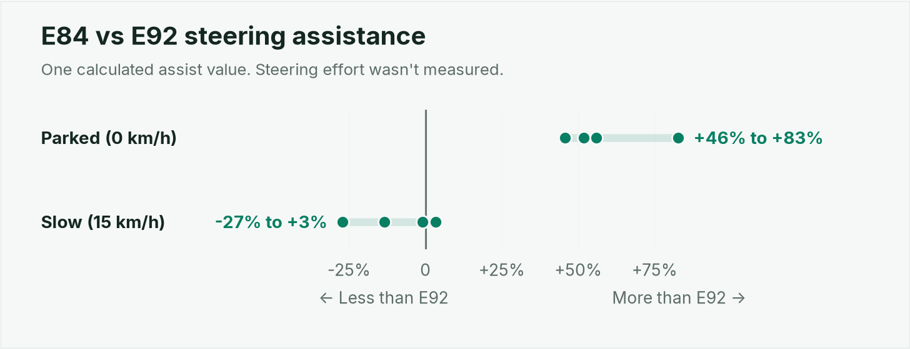

# E84 steering coding on my BMW E92

> I believe there must be a way to unlock Servotronic for free. I just haven't found it. Maybe you can, with the help of your AI agents. If you do, please contact me or open a PR!

Changing my E92's steering setting to **E84_basis** made parking much easier. It still feels very good on the highway. I've been driving with it daily for roughly a week or two, possibly longer, as reported on 16 November 2026.

This selects a setting already present in the electric power steering controller, or EPS. The saved diagnostic reads confirm that it stayed active after an ignition cycle. It did not unlock Servotronic, which was the original goal.



At the four tested inputs, this part of the calculation was **46-83% higher while parked**. That does not mean the wheel is 46-83% lighter. At 15 km/h, the same value ranged from 27% lower to 3% higher. [Method and every sample](docs/comparison.md).

## Want to try this with your AI agent?

Give it this repository and the prompt below. You don't need to understand the research first. The agent should start by identifying your steering controller and comparing it with mine.

```text
Read AGENTS.md and follow docs/agent-guide.md.
I want to know whether the E84 steering setting could apply to my BMW.
Start with the minimum details you need about my car and explain things
in plain language. Check the failed attempts before suggesting a route.
Before any change to the car, show me the exact plan, the original coding
backup, how to restore it, and what could go wrong. Don't assume my car
matches the author's just because both are E92s.
```

The [replication guide](docs/replication.md) covers the evidence needed before changing anything. My experience with one car does not establish that the setting is suitable for every E92.

## What changed on my car?

| Setting | Before | After |
| --- | --- | --- |
| Stored steering profile | E92_basis, `09` | E84_basis, `0E` |
| Active profile after ignition cycle | E92_basis | E84 without Servotronic, `E84 ohne SA216` |

The recorded change was **coding**, which selects existing settings. It was not an E84 firmware flash. No new Servotronic licence was created. [The full outcome](docs/outcome.md) includes the accepted write, a later tool error, and the independent readbacks.

My car was identified as a 2012 BMW E92 LCI 318i, N43 engine, model code `KD91`. The EPS reported application `6855892`, coding index `03`, hardware `6851800`, and program reference `0512IC0F780A`. These are useful comparison points, but they do not identify the complete physical steering rack.

## Continue the research

- [Failed approaches](docs/failed-approaches.md) explains what didn't work and why.
- [Open questions](docs/open-questions.md) shows where new evidence could help.
- [Technical findings](docs/technical-findings.md) covers the controller and calibration analysis.
- [All 114 attempts](docs/attempts.md) preserves the research record, also available as [JSON](data/attempts.json).
- [Timeline](docs/timeline.md) follows the investigation from the original unlock goal to E84 coding.
- [Tooling pitfalls](docs/tooling-pitfalls.md) covers wrong-module selection and partial job errors.
- [Evidence](docs/evidence.md) explains the sources and reproduction limits.

VINs, raw conversations, personal paths, BMW firmware, third-party manuals, and vehicle connection tools are excluded. See the [source and contribution notes](RIGHTS.md).

To check the public files without connecting to a car:

```sh
python3 scripts/check_repository.py
```

This project is independent of BMW.
